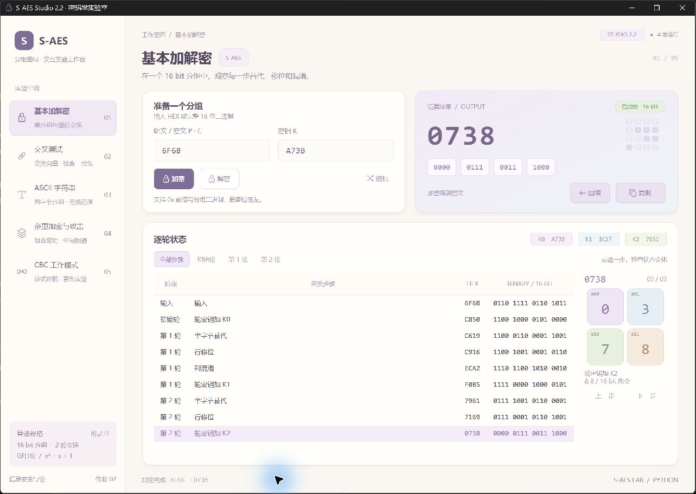

# S-AES 算法实现与五关实验

《信息安全导论》作业 2。我们用 **Python + PySide6 / Qt Widgets** 实现了 S-AES 桌面程序，完成单分组加解密、交叉测试、ASCII 字符串、多重加密、中间相遇攻击，以及 CBC 篡改对比。

分组和基本密钥均为 **16 bit**。当前界面版本为 **Studio 2.2**，采用奶白与低饱和彩色主题；算法和命令行可以独立运行。

**阅读入口：** [作业要求](docs/作业要求.md) · [五关结果](#results) · [截图说明](docs/截图说明.md) · [快速运行](#quickstart) · [目录与文档](#files) · [Word 实验报告](docs/S-AES实验报告_截图演示版.docx)

## 这个实验做了什么

先把一个分组的加解密跑通，再用独立实现核对结果；接着处理字符串，扩展到双重、三重加密和中间相遇攻击，最后在 CBC 模式下观察密文被改动后的变化。

| 关卡 | 本项目的实现 | 结果入口 |
| --- | --- | --- |
| **1 基本测试** | 16 bit 加解密、HEX/二进制输入、轮密钥和逐轮矩阵 | [加密](截图与视频/第1关_加密.png)、[解密](截图与视频/第1关_解密.png)、[中间状态](截图与视频/第1关_逐轮状态.png) |
| **2 交叉测试** | JSON 导入导出、Python 与独立 C++ 实现互验 | [1005 组比对截图](截图与视频/第2关_交叉测试.png)、[逐行 CSV](docs/results/cross_check.csv) |
| **3 字符串扩展** | ASCII 每两字节分组、补零和原长度保存、密文字节预览 | [加密](截图与视频/第3关_字符串加密.png)、[解密](截图与视频/第3关_字符串解密.png)、[示例密文包](docs/results/ascii_cipher.json) |
| **4 多重加密** | 双重 EE、两种三重 EEE、完整中间相遇搜索与取消 | [双重](截图与视频/第4关_双重加密.png)、[三重](截图与视频/第4关_三重加密.png)、[攻击结果](截图与视频/第4关_中间相遇攻击.png) |
| **5 CBC 模式** | 随机或手动 IV、共享 IV、翻转或替换密文分组 | [正常加密](截图与视频/第5关_CBC加密.png)、[翻转密文](截图与视频/第5关_翻转密文.png)、[替换分组](截图与视频/第5关_替换分组.png) |



<a id="results"></a>
## 五关实验结果

详细记录见 [测试报告](docs/测试报告.md)，15 张实际桌面截图的操作步骤见 [截图说明](docs/截图说明.md)。Word 报告保存在 [docs](docs/S-AES实验报告_截图演示版.docx) 中。

### 第 1 关 一个分组的加密与解密

| 操作 | 输入 | 密钥 | 输出 |
| --- | --- | --- | --- |
| 加密 | `6F6B` | `A73B` | `0738` |
| 解密 | `0738` | `A73B` | `6F6B` |

这组数据的轮密钥为 `A73B → 1C27 → 7651`。界面可以逐步查看半字节替代、行移位、列混淆和轮密钥加；输入被修改后会提示重新计算，避免误用旧结果。

自动测试还检查了 **10000 组往返**，以及固定密钥 `2D55` 下 **65536 个明文的输出无重复**。教材的密钥扩展示例 `2D55 → BCE9 → A34A` 也单独核对。

### 第 2 关 用独立实现核对

Python 与 [独立 C++ 参考实现](tests/reference_saes.cpp) 实际比对 **1005/1005 组通过**，同时检查加密、任意密文解密和双方互解。可查看 [测试说明](docs/results/cross_check.md)、[完整 CSV](docs/results/cross_check.csv) 和 [界面演示向量](docs/results/cpp_demo_vectors.json)。

这份记录来自本机两种语言的独立实现。与另一小组的现场测试需要实际交换数据后填写 [交叉测试记录模板](docs/交叉测试记录模板.md)。

### 第 3 关 把字符串加密后还原

`Hello, S-AES!` 共 13 个 ASCII 字节，按两字节分为 7 组，密钥为 `A73B`：

```text
2B91 7F2D 7CBD BBB5 2F04 658A 472C
```

最后一组补一个零字节，JSON 同时保存原长度。解密可以准确还原原文，也能处理空串、尾部零字节和换行。密文字节中不能打印的部分用 `\xHH` 显示，交换时使用 [JSON 密文包](docs/results/ascii_cipher.json)。

### 第 4 关 多重加密与中间相遇攻击

以下三种模式的输入均为 `6F6B`，解密均恢复为 `6F6B`。

| 模式 | 组合密钥 | 密文 |
| --- | --- | --- |
| 双重 EE / 32 bit | `1F2E3D4C` | `FE80` |
| 三重 EEE / 48 bit | `1F2E3D4C5A6B` | `5AF9` |
| 三重 EEE / 32 bit，K1-K2-K1 | `1F2E3D4C` | `FF78` |

用 `(6F6B, FE80)`、`(1234, 69D8)`、`(BEEF, 093D)` 三组已知对搜索双重密钥，唯一候选为 **`1F2E3D4C`**。[实际截图](截图与视频/第4关_中间相遇攻击.png) 中该次运行耗时 **1.71 秒**；自动验证报告里的耗时是另外的运行记录。只有一组已知对时会留下多个候选，需要继续筛选。

### 第 5 关 CBC 与密文篡改

使用 `K=A73B`、`IV=1357` 加密 `Hello, S-AES CBC mode!`，得到 11 个分组。接收方从 [密文包](docs/results/cbc_cipher.json) 读取共享 IV 后可以还原原文。

| 实验 | 解密后的变化 |
| --- | --- |
| 把 C1 从 `84A5` 翻转为 `84A4` | P1 从 `4865` 变为 `8869`，P2 从 `6C6C` 变为 `6C6D`，P3 起不变 |
| 把 C2 从 `D154` 替换为 `0000` | P1 不变，P2 变为 `A217`，P3 变为 `BE78`，P4 起不变 |

修改一个密文分组会影响当前和下一明文分组。逐组 XOR 差值见 [五关自动验证记录](docs/results/五关测试结果.md)。CBC 本身不提供完整性认证。

## 算法标准

以课程提供的《附录 D 简化 AES》为准，完整说明见 [算法标准](docs/算法标准.md)。

```text
状态：n0 n1 n2 n3 → [n0 n2; n1 n3]
S盒：9 4 A B / D 1 8 5 / 6 2 0 3 / C E F 7
轮常量：80、30
GF(2^4)：模 x^4+x+1，即 0x13
列混淆：[1 4;4 1]；逆列混淆：[9 2;2 9]
```

历史 C++ 压缩包中的 S 盒和第二轮常量与本次教材不同。用于交叉测试的参考实现已采用上述参数；运行桌面程序不需要 C++。课程 PDF 不随项目分发。

<a id="quickstart"></a>
## 快速运行

### 打开桌面程序

需要 **Python 3.10+**。Windows 双击根目录的 `启动程序.bat`：首次会创建 `.venv` 并安装依赖，以后直接打开窗口。

也可以在项目根目录手动运行：

```powershell
python -m venv .venv
.venv\Scripts\python -m pip install -r requirements.txt
.venv\Scripts\python app.py
```

macOS/Linux 创建并激活虚拟环境后，执行 `pip install -r requirements.txt` 和 `python app.py`。五个页面的操作和快捷键见 [用户指南](docs/用户指南.md)。

### 命令行

```powershell
python -m saes encrypt 6F6B A73B
python -m saes decrypt 0738 A73B
python -m saes encrypt 6F6B 1F2E3D4C --mode double
python -m saes encrypt 6F6B 1F2E3D4C5A6B --mode triple48
```

### 复现实验

| 目的 | 在项目根目录执行 |
| --- | --- |
| 算法和模式的 30 项测试 | `python -m unittest discover -s tests -v` |
| 五关验证及独立 C++ 互测 | `python -X utf8 tools/verify.py` |
| Qt 界面的 41 项检查 | `.venv\Scripts\python -X utf8 tools/gui_smoke.py --offscreen` |
| 检查本地文档链接和素材 | `python tools/check_repository.py` |
| 生成整理后的交付包 | `python tools/package_release.py` |

Windows 也可双击 `运行测试.bat`。C++ 互测需要 `g++`；缺少编译器时会如实记为未执行，也可传入 `--skip-cpp`。验证会更新 `docs/results`，截图里的历史运行耗时保持原记录。

<a id="files"></a>
## 目录与文档

```text
S-AES算法实现/
├─ README.md                项目介绍、五关结果和运行入口
├─ app.py                   桌面启动入口
├─ requirements.txt         Qt 依赖
├─ 启动程序.bat / 运行测试.bat
├─ saes/                    Python 算法、模式、攻击、GUI 和命令行
├─ tests/                   单元测试与独立 C++ 参考实现
├─ tools/                   验证、界面检查、仓库检查和打包脚本
├─ docs/                    作业要求、指南、手册、报告、截图说明
│  └─ results/              CSV、JSON、原始测试日志和自动验证记录
└─ 截图与视频/              按第1关至第5关命名的 15 张实际截图
```

| 入口 | 内容 |
| --- | --- |
| [文档导航](docs/README.md) | 按阅读顺序查找实验材料 |
| [作业要求](docs/作业要求.md) | 五关任务、代码规范和提交清单 |
| [用户指南](docs/用户指南.md) | 环境、输入规则、五页操作和常见问题 |
| [开发手册](docs/开发手册.md) | 模块分工、核心 API、密文包和线程设计 |
| [算法标准](docs/算法标准.md) | 位序、S 盒、轮常量和教材核对 |
| [测试报告](docs/测试报告.md) | 五关结果、原始证据和复现命令 |
| [截图说明](docs/截图说明.md) | 15 张图的输入、操作和结果 |
| [Word 实验报告](docs/S-AES实验报告_截图演示版.docx) | 截图演示与口语化实验说明 |
| [交叉测试记录模板](docs/交叉测试记录模板.md) | 供实际参与现场互测的双方填写 |
| [截图与视频](截图与视频/README.md) | 原图索引；目前收录截图 |
| [仓库整理说明](docs/仓库整理说明.md) | 文件去向、归档规则和提交方式 |

主要源码：[核心算法](saes/core.py) · [字节编码](saes/encoding.py) · [多重加密](saes/multiple.py) · [中间相遇](saes/attacks.py) · [CBC 与密文包](saes/modes.py) · [Qt 交互](saes/qt_gui.py) · [Qt 布局](saes/qt_ui.py)

本地的 `本地归档/` 保存旧交付包、历史截图、原始源码阅读副本和报告制作过程；`.venv/`、`build/`、`dist/` 为本机环境或生成物，均由 `.gitignore` 排除。`dist/S-AES-Studio-2.2.zip` 是打包脚本生成的提交材料。

整理方式参考 [Information_Security_Lab1](https://github.com/Qisheng-Zhang/Information_Security_Lab1) 的源码包、测试目录、文档导航和按关卡命名的演示素材；本项目的算法与测试结果按 S-AES 实验独立保留。
